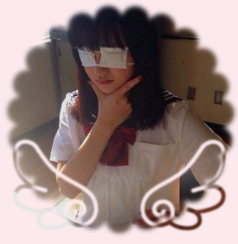
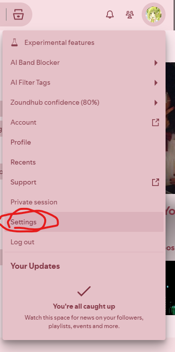
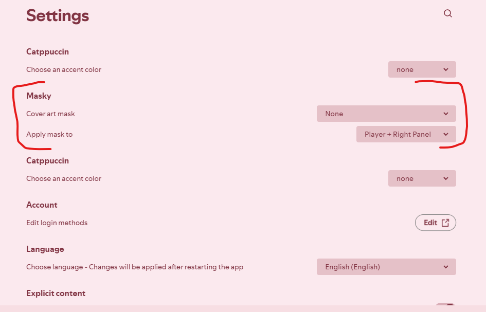

# Masky Stencils

Custom cover-art masks for Spotify via [Spicetify](https://spicetify.app/) + [Masky extension](https://github.com/kaiberriezz/masky).

Drop PNG stencils in the folder, run the watcher, apply — your album art gets masked instantly.

---

## Preview



*The player bar (bottom) and right now-playing panel both masked with the selected stencil.*

---

## Installation

### 1. Install Masky Extension

Copy `masky.js` and `watch-masky.ps1` to your Spicetify Extensions folder:

```powershell
# Extensions folder (auto-copied on apply)
%APPDATA%\spicetify\Extensions\
```

Add to your `config-xpui.ini` (or run once via CLI):

```ini
extensions = masky-masks.js|masky.js|song-downloader.js|spicy-lyrics.mjs
```

Then apply:

```powershell
spicetify apply
```

> **Restart Spotify** after first install.

---

### 2. Add Stencils

Drop your `.png` stencil files into:

```
%APPDATA%\spicetify\Extensions\masky-stencils\
```

Filenames can include credits in parentheses, e.g.:
- `star (artistname).png`
- `heart (credits nyotsoba on tumblr).png`

---

### 3. Build Manifest

Run the watcher once (or leave it running for auto-rebuild on new files):

```powershell
powershell -File "%APPDATA%\spicetify\Extensions\watch-masky.ps1"
```

You should see:
```
[HH:MM:SS] Built masky-masks.js with 29 mask(s)
Watching ... for PNG changes...
```

Press `Ctrl+C` after the build line if you don't want the watcher running.

---

### 4. Apply

```powershell
spicetify apply
```

---

## Usage

### Open Settings



> **Go to your profile (top-right) → Settings**

### Find Masky Section



> **In Settings, scroll to the "Extensions" category → Masky**

### Pick a Mask

- **Cover art mask** — choose from 29 stencils, `circle`, or `none`
- **Apply mask to** — `both` (player + panel), `player`, `panel`, or `all`

Changes apply instantly — no restart needed after the first run.

---

## Stencils Included (29)

| Preview | Name | Artist |
|---------|------|--------|
|  | B.E.N | thespiritbaresitskills |
|  | blood splatter | mydarlingedits |
|  | bunny ascii w bow | artificial5u1c1d3 |
|  | cat1 | src-rat |
|  | cat2 | dollsciples |
|  | cupcake | dropletknightss |
|  | cutegore ahh | artificial5u1c1d3 |
|  | dog1 | dollsciples |
|  | furridot | toybox-starsys |
|  | gambler1 | cynthiadrops |
|  | heart | uncredited |
|  | hello kitty 1 | nyotsoba |
|  | hello kitty 2 | nyotsoba |
|  | hello kitty 3 | nyotsoba |
|  | holy vaporwave weirdcore 1 | artificial5u1c1d3 |
|  | holy vaporwave weirdcore 2 | artificial5u1c1d3 |
|  | jeff | thespiritbaresitskills |
|  | laughing jack | thespiritbaresitskills |
|  | melty luv | tuxbit |
|  | pompom | cynthiadrops |
|  | Proxy | thespiritbaresitskills |
|  | scalloped circle w wings 1 | nyotsoba |
|  | scalloped circle w wings 2 | nyotsoba |
|  | scalloped circle w wings 3 | nyotsoba |
|  | space | src-rat |
|  | space ufo | dropletknightss |
|  | square pawprints | artificial5u1c1d3 |
|  | ticci toby | thespiritbaresitskills |
|  | very (straw)berry | src-rat |

---

## Adding Your Own Stencils

1. Create a **250×250 px PNG** with transparency (alpha channel = mask)
2. Name it: `your-name (artistname).png`
3. Drop in `%APPDATA%\spicetify\Extensions\masky-stencils\`
4. Rebuild:

```powershell
powershell -File "%APPDATA%\spicetify\Extensions\watch-masky.ps1"
spicetify apply
```

The watcher auto-detects new/removed files if left running.

---

## File Structure

```
masky-stencils/
├── stencils/                 # 29 PNG stencils (credits in filenames)
├── manifest.json             # Metadata (id, name, artist, source)
├── watch-masky.ps1           # Auto-build watcher (FileSystemWatcher)
├── build_masks.py            # Alternative Python builder
├── index.js                  # Custom App entry point (for Spicetify)
├── screenshots/
│   ├── preview.png           # Player bar + panel masked
│   ├── settings-entry.png    # Profile → Settings
│   └── settings-masky.png    # Extensions → Masky section
└── README.md
```

---

## Credits

All stencils credited in filenames and `manifest.json`. Major contributors:

| Artist | Stencils | Tumblr |
|--------|----------|--------|
| artificial5u1c1d3 | 5 | [artificial5u1c1d3.tumblr.com](https://artificial5u1c1d3.tumblr.com) |
| thespiritbaresitskills | 6 | [thespiritbaresitskills.tumblr.com](https://thespiritbaresitskills.tumblr.com) |
| nyotsoba | 6 | [nyotsoba.tumblr.com](https://nyotsoba.tumblr.com) |
| src-rat | 4 | [src-rat.tumblr.com](https://src-rat.tumblr.com) |
| dollsciples | 2 | [dollsciples.tumblr.com](https://dollsciples.tumblr.com) |
| cynthiadrops | 2 | [cynthiadrops.tumblr.com](https://cynthiadrops.tumblr.com) |
| dropletknightss | 2 | [dropletknightss.tumblr.com](https://dropletknightss.tumblr.com) |
| mydarlingedits | 1 | [mydarlingedits.tumblr.com](https://mydarlingedits.tumblr.com) |
| toybox-starsys | 1 | [toybox-starsys.tumblr.com](https://toybox-starsys.tumblr.com) |
| tuxbit | 1 | [tuxbit.tumblr.com](https://tuxbit.tumblr.com) |

> If you're an artist and want your work removed or credited differently, open an issue.

---

## License

Personal use only. Stencils belong to their respective artists.
